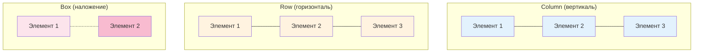
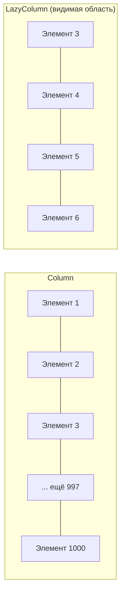
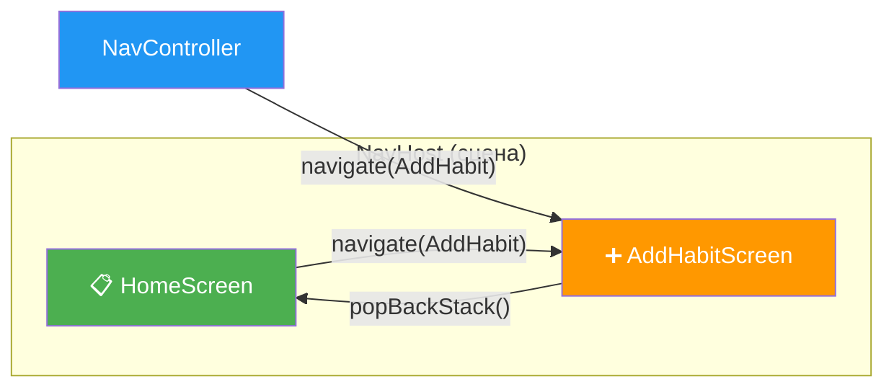
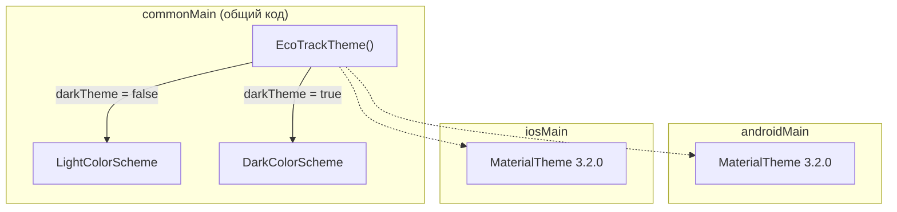
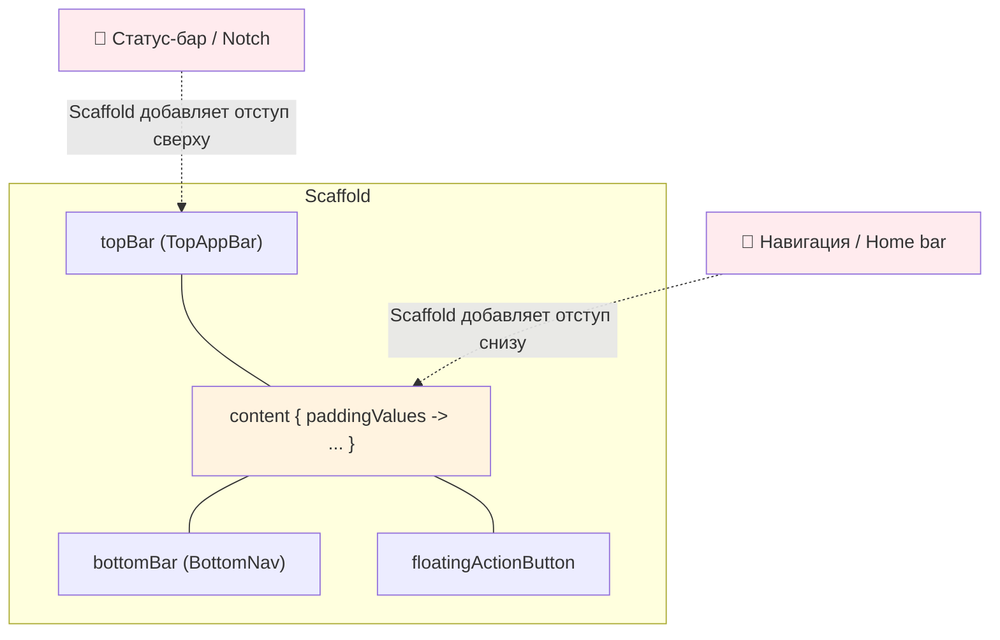
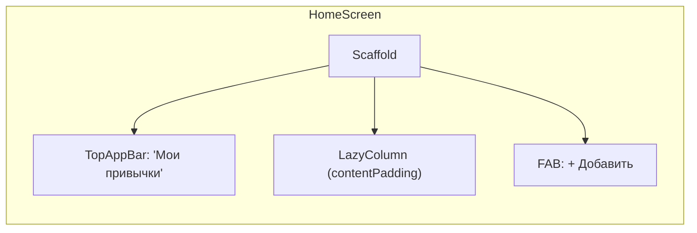
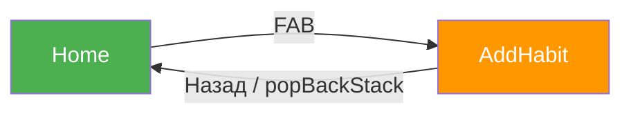
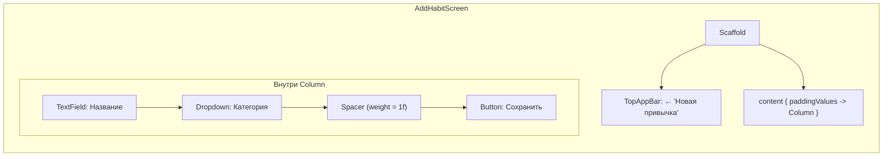

# 📘 Модуль 2: UI-разработка на Compose Multiplatform

Представь: в прошлом модуле ты написал приложение, которое выводит «Hello, Multiplatform!» на экран. Круто, правда? Но это как заехать на новую машину и проехать на ней ровно 5 метров. Машина едет — отлично. Но мы-то хотим на ней куда-то поехать.

В этом модуле мы превратим заглушку в настоящее приложение: сделаем список, навигацию между экранами, тему и разберёмся, как не дать контенту «уехать» под системные панели.

**Что ты получишь к концу модуля:**


**План модуля:**
1. Layout-система: как Compose «видит» элементы на экране
2. Списки: `LazyColumn` — когда 1000 элементов не убьют твой FPS
3. Навигация: перемещение между экранами
4. Темизация: Material3
5. Scaffold и Safe Areas: главный друг и главный враг
6. Практика: собираем всё вместе

**Время:** ~10–12 часов.

---

## 1. Layout-система: как устроена «картинка»

### Ментальная модель

Представь, что ты дизайнер, который раскладывает магнитные наклейки на доске. Каждая наклейка — это UI-элемент. У тебя есть три основных «магнита»:

| Магнит | Что делает | Аналогия |
|--------|-----------|----------|
| `Column` | Ставит элементы **вертикально** (один под другим) | Колонка на сайте |
| `Row` | Ставит элементы **горизонтально** (рядом) | Строка в таблице |
| `Box` | Накладывает элементы **друг на друга** | Стаканы в стакане |

Вот как это выглядит:



**Ключевое отличие от Android-XML:** в Compose ты не вложен XML-теги. Ты вложен *вызовы функций*. `Column { ... }` — это функция, которая принимает лямбду с контентом. Поэтому всё то, что ты кладёшь внутрь фигурных скобок, становится «ребёнком» этого контейнера.

```kotlin
Column {          // ← вертикальный контейнер
    Text("Заголовок")   // ← первый ребёнок (сверху)
    Text("Подзаголовок") // ← второй ребёнок (ниже)
    Button("Кнопка") { } // ← третий ребёнок (ещё ниже)
}
```

### Модификаторы: «надстройки» для элементов

Вот тут начинается магия. Представь, что каждый UI-элемент — это кирпич. Сам по себе он квадратный и без краски. **Модификатор** — это то, что ты делаешь с кирпичом: красишь его, делаешь длиннее, приклеиваешь руку, чтобы по нему можно было жать.

```kotlin
Button(
    modifier = Modifier
        .padding(16.dp)      // ← отступы вокруг
        .fillMaxWidth()      // ← растянуть на всю ширину
        .clickable { ... }   // ← сделать кликабельным
    onClick = { }
) { Text("Нажми меня") }
```

**Правило №1:** `modifier` — всегда **первый** именованный параметр.

**Правило №2 (самое важное!):** Порядок цепочки имеет значение. Модификаторы применяются **слева направо**, как слои обёртки:

```kotlin
// ВАРИАНТ А: сначала растягиваем, потом отступ
Modifier.fillMaxWidth().padding(16.dp)
// → элемент занимает всю ширину, внутри — отступ 16dp
// → визуальный эффект: отступы ВНУТРИ ширины

// ВАРИАНТ Б: сначала отступ, потом растягиваем  
Modifier.padding(16.dp).fillMaxWidth()
// → сначала добавляем отступ, потом растягиваем на оставшееся
// → визуальный эффект: отступы СНАРУЖИ, элемент на всю ширину минус отступы
```

Почему это важно? Попробуй мысленно:
- `fillMaxWidth().padding(16.dp)` — как взять лист А4 и нарисовать рамку **внутри** его границ
- `padding(16.dp).fillMaxWidth()` — как взять лист и обрезать его с каждой стороны, а потом растянуть на оставшееся

Один и тот же набор действий, но результат визуально отличается.

### Списки: Column vs LazyColumn

Вот вопрос, на который часто отвечают неправильно на собеседованиях:

> **В чём разница между `Column` и `LazyColumn`?**

Ответ не в «Column — обычный, Lazy — быстрый». Разница фундаментальная:



**`Column`** создаёт **все** элементы сразу. Если у тебя 1000 элементов — Compose создаст 1000 `Text`, 1000 `Icon` и так далее. Память: 💀.

**`LazyColumn`** создаёт **только те** элементы, которые сейчас видны на экране (или чуть-чуть за его пределами для плавного скролла). Прокрутил вниз — Compose «перекраивает»: уничтожает ушедшие элементы и создаёт новые.

**Правило выбора:**
- ≤ 20 элементов и они не меняются → `Column`
- > 20 элементов, динамический список, лента → **`LazyColumn`**

---

## 2. Навигация: как перейти с одного экрана на другой

### Проблема

Представь мобильное приложение. У тебя есть экран «Мои привычки» (список). Пользователь жмёт на плюсик — и ему нужно показать **другой** экран: «Новая привычка». Жмёт «Назад» — возвращаемся к списку.

Как это реализовать? Нужен механизм навигации.

### Как это устроено

В Compose Multiplatform мы используем **`androidx.navigation:navigation-compose`**. Это единый механизм, который работает одинаково на Android и iOS.

Думай о `NavHost` как о **сцене в театре**. На сцене может быть только **один** экран (актёр). `NavController` — это **режиссёр**, который говорит: «Сейчас выйдет актёр A, а войдёт актёр B».



**Три ключевых объекта:**

| Объект | Роль | Аналогия |
|--------|------|----------|
| `NavHost` | Контейнер, который показывает текущий экран | Сцена |
| `NavController` | Управляет переходами | Режиссёр |
| `composable<Screen>` | Регистрирует экран и его аргументы | Роль в пьесе |

### Type-safe навигация: почему это важно

До версии 2.8.0 маршруты выглядели как строки:

```kotlin
// Старый способ (2.7.x)
composable("habit_detail/{habitId}") { backStackEntry ->
    val habitId = backStackEntry.arguments?.getString("habitId") ?: ""
    HabitDetailScreen(habitId = habitId)
}

navController.navigate("habit_detail/123")
```

Проблема? Если ты опечатался `"habit_deatil"` — узнаешь только в рантайме, когда пользователь нажмёт кнопку. И если хочешь передать не строку, а объект — придётся сериализовать в JSON.

**С 2.8.0** можно так:

```kotlin
// Новый способ (2.8.0+)
composable<HabitDetailArgs> { args ->
    HabitDetailScreen(habitId = args.habitId)
}

navController.navigate(HabitDetailArgs(habitId = "123"))
```

Опечатка в поле `habtid` → **ошибка компиляции**. Компилятор защитит тебя.

### Подключение в KMP

В KMP-проекте зависимости добавляются **внутри `kotlin { sourceSets { ... } }`** блока, а не в обычный `dependencies`. Почему? Потому что у нас разные sourceSets для разных платформ, и Gradle должен знать, *куда* положить зависимость.

<details>
<summary>🔍 Развернуть: как подключить библиотеку навигации</summary>

#### Вариант 1: Gradle Kotlin DSL

Открой `shared/build.gradle.kts`:

```kotlin
kotlin {
    sourceSets {
        commonMain.dependencies {
            // Навигация — общий код
            implementation("androidx.navigation:navigation-compose:2.8.0")
            // Сериализация — нужна для type-safe навигации
            implementation("org.jetbrains.kotlinx:kotlinx-serialization-json:1.6.3")
        }
    }
}
```

#### Вариант 2: Version Catalog (рекомендуется для новых проектов)

Файл `gradle/libs.versions.toml`:

```toml
[versions]
navigation-compose = "2.8.0"
serialization = "1.6.3"

[libraries]
navigation-compose = { group = "androidx.navigation", name = "navigation-compose", version.ref = "navigation-compose" }
serialization-json = { group = "org.jetbrains.kotlinx", name = "kotlinx-serialization-json", version.ref = "serialization" }
```

И в `shared/build.gradle.kts`:

```kotlin
kotlin {
    sourceSets {
        commonMain.dependencies {
            implementation(libs.navigation.compose)
            implementation(libs.serialization.json)
        }
    }
}
```

**Зачем Version Catalog?** Все версии в одном месте. Когда придёт новая версия — меняешь в `libs.versions.toml`, а не гуглишь, в каких 5 файлах она написана.

</details>

<details>
<summary>🔍 Развернуть: подключение плагина сериализации (обязательно для type-safe навигации!)</summary>

Type-safe навигация использует `@Serializable` — аннотацию из `kotlinx.serialization`. Для этого нужен **плагин**.

**Шаг 1:** В корневом `settings.gradle.kts`:

```kotlin
pluginManagement {
    repositories {
        google()
        mavenCentral()
        gradlePluginPortal()
    }
}
```

**Шаг 2:** В корневом `build.gradle.kts`:

```kotlin
plugins {
    alias(libs.plugins.kotlin.serialization) // если через Version Catalog
    // или:
    // id("org.jetbrains.kotlin.plugin.serialization") version "2.0.21"
}
```

**Шаг 3:** В `shared/build.gradle.kts` — плагин тоже нужно применить:

```kotlin
plugins {
    alias(libs.plugins.kotlin.multiplatform)
    alias(libs.plugins.kotlin.serialization)
}
```

</details>

### На iOS — нюанс

На iOS системная кнопка «Назад» (жест свайпа) работает **автоматически** через `NavHost`. Тебе не нужно ничего дописывать — Compose Multiplatform сам синхронизирует `NavBackStack` с нативным `UINavigationController`. Просто убедись, что `NavHost` создан внутри `ComposeUIViewController`.

---

## 3. Темизация: Material3

### Почему Material3, а не Material?

Material Design 2 (та самая «жёлтая кнопка») имела ограниченную гибкость: тёмная тема — это отдельная палитра, которую надо было держать руками. Material3 ввело **ColorScheme** — системный подход, где все цвета связаны друг с другом через «seed color».

Думай об этом как о **брендовой палитре**. Ты выбираешь один основной цвет, а Material3 сам выводит от него все остальные: фон, текст, кнопки, акценты. А для тёмной темы — генерирует отдельный набор из того же seed.

### Структура темы



Ключевой момент: **определение** ColorScheme живёт в `commonMain`. **Переключение** тёмной/светлой темы — тоже в `commonMain`. А вот **системная тема** (следить за настройками устройства) подключается на платформенном уровне.

<details>
<summary>🔍 Развернуть: реализация темы</summary>

```kotlin
// commonMain/kotlin/ui/theme/Color.kt
package com.ecotrack.ui.theme

import androidx.compose.ui.graphics.Color

// Seed color — ваш фирменный
val EcoGreen = Color(0xFF2E7D32)
val EcoGreenDark = Color(0xFF1B5E20)

// Лёгкая тема
val LightGreenContainer = Color(0xFFB7F2B7)
val LightOnGreenContainer = Color(0xFF0A2A0A)
val LightBackground = Color(0xFFF7FDF5)
val LightSurface = Color(0xFFFFFBF0)

// Тёмная тема  
val DarkGreenContainer = Color(0xFF1A471C)
val DarkOnGreenContainer = Color(0xFFB7F2B7)
val DarkBackground = Color(0xFF171C17)
val DarkSurface = Color(0xFF111411)
```

```kotlin
// commonMain/kotlin/ui/theme/Theme.kt
package com.ecotrack.ui.theme

import androidx.compose.material3.*
import androidx.compose.runtime.Composable
import androidx.compose.ui.graphics.Color

// Палитры
private val LightColors = lightColorScheme(
    primary = EcoGreen,
    onPrimary = Color.White,
    primaryContainer = LightGreenContainer,
    onPrimaryContainer = LightOnGreenContainer,
    background = LightBackground,
    surface = LightSurface,
)

private val DarkColors = darkColorScheme(
    primary = Color(0xFF7FD47F),
    onPrimary = Color(0xFF003810),
    primaryContainer = DarkGreenContainer,
    onPrimaryContainer = DarkOnGreenContainer,
    background = DarkBackground,
    surface = DarkSurface,
)

@Composable
fun EcoTrackTheme(
    darkTheme: Boolean = false,
    content: @Composable () -> Unit
) {
    MaterialTheme(
        colorScheme = if (darkTheme) DarkColors else LightColors,
        content = content
    )
}
```

**Важно:** параметр `darkTheme` — это просто `Boolean`. Кто-то где-то его управляет. В будущем мы подключим системную тему. Сейчас — переключатель в UI.

</details>

---

## 4. Scaffold и Safe Areas: главный друг и главный враг

### Проблема

Ты запускаешь приложение на iPhone 15 Pro Max. И что видишь?

```
┌─────────────────────────────────┐
│  ● Dynamic Island ●            │  ← системная зона
│                                │
│  ┌───────────────────────────┐ │
│  │  Мой контент ушёл под    │ │  ← контент ЗА системной панелью!
│  │  вырез и под home bar    │ │
│  │                         │ │
│  │                         │ │
│  │                         │ │
│  │                         │ │
│  └───────────────────────────┘ │
│              ━━━               │  ← home indicator
└─────────────────────────────────┘
```

Контент **перекрывается** системными панелями. Пользователь не видит верхнюю строку списка, и нижняя кнопка скрывается под полоской.

На Android та же проблема: статус-бар сверху (время, батарея) и навигационная панель снизу.

### Решение: Scaffold

**Scaffold** — это «каркас» экрана. Он делает три вещи:

1. **Рисует** системные панели (topBar, bottomBar, FAB)
2. **Вычисляет** отступы до системных зон
3. **Передаёт** эти отступы в `content` через `paddingValues`



**Критически важно:** `paddingValues`, которые Scaffold передаёт в `content`, — это **не опциональная** вещь. Если ты их игнорируешь — контент будет под системными панелями.

### Частые ошибки

**Ошибка 1: Забыл `contentPadding`**

```kotlin
// ❌ Контент уедет под статус-бар
Scaffold(
    topBar = { TopAppBar(title = { Text("Привычки") }) },
    content = { paddingValues ->
        LazyColumn(
            modifier = Modifier.fillMaxSize()
            // ← забыли contentPadding = paddingValues
        ) { ... }
    }
)
```

```kotlin
// ✅ Правильно
Scaffold(
    topBar = { TopAppBar(title = { Text("Привычки") }) },
    content = { paddingValues ->
        LazyColumn(
            modifier = Modifier.fillMaxSize(),
            contentPadding = paddingValues  // ← отступы!
        ) { ... }
    }
)
```

**Ошибка 2: Двойные отступы**

```kotlin
// ❌ Scaffold уже добавил отступ сверху, а мы добавили ещё 56.dp
Scaffold(
    content = { paddingValues ->
        Column(
            modifier = Modifier
                .padding(paddingValues)
                .padding(56.dp)  // ← двойной отступ сверху!
        ) { ... }
    }
)
```

**Правило:** `paddingValues` от Scaffold — это «системные отступы». Свои дизайн-отступы (16.dp) добавляй **внутри** контента, а не поверх `paddingValues`.

---

## 5. Практика: список привычек

Теперь будем собирать всё вместе. Подходим как разработчики: **сначала думаем о структуре, потом пишем код**.

### Шаг 1: Модель данных

Перед UI нам нужна модель. Это данные, которые мы будем показывать в UI.

<details>
<summary>🔍 Развернуть: Habit.kt</summary>

```kotlin
// commonMain/kotlin/data/model/Habit.kt
package com.ecotrack.data.model

data class Habit(
    val id: String,
    val title: String,
    val category: String,    // "Транспорт", "Мусор", "Энергия"
    val isCompleted: Boolean = false,
    val date: String         // "24.10"
)
```

Простой `data class`. Пока без сериализации — это только для UI.

</details>

### Шаг 2: Карточка привычки

Думай о `HabitCard` как о **кирпичике** из конструктора. Она самодостаточна: принимает данные и callback на клик. Не знает, где её нарисуют. Не знает, в каком списке.

**Что нам нужно:**
- Иконка слева (галочка если выполнено, обычная если нет)
- Название и категория по центру
- Дата справа
- Всё в `Row` внутри `Card`

<details>
<summary>🔍 Развернуть: HabitCard.kt</summary>

```kotlin
// commonMain/kotlin/ui/components/HabitCard.kt
package com.ecotrack.ui.components

import androidx.compose.foundation.layout.*
import androidx.compose.material.icons.Icons
import androidx.compose.material.icons.filled.Check
import androidx.compose.material.icons.outlined.CheckCircle
import androidx.compose.material3.*
import androidx.compose.runtime.Composable
import androidx.compose.ui.Alignment
import androidx.compose.ui.Modifier
import androidx.compose.ui.graphics.Color
import androidx.compose.ui.text.font.FontWeight
import com.ecotrack.data.model.Habit

@Composable
fun HabitCard(
    habit: Habit,
    onClick: () -> Unit
) {
    Card(
        modifier = Modifier
            .fillMaxWidth()
            .padding(horizontal = 16.dp, vertical = 8.dp),
        colors = CardDefaults.cardColors(
            containerColor = if (habit.isCompleted)
                MaterialTheme.colorScheme.surfaceVariant
            else
                MaterialTheme.colorScheme.surface
        )
    ) {
        Row(
            modifier = Modifier
                .padding(16.dp)
                .fillMaxWidth(),
            verticalAlignment = Alignment.CenterVertically,
            onClick = onClick
        ) {
            Icon(
                imageVector = if (habit.isCompleted)
                    Icons.Filled.Check
                else
                    Icons.Outlined.CheckCircle,
                contentDescription = if (habit.isCompleted) "Выполнено" else "Не выполнено",
                tint = if (habit.isCompleted)
                    MaterialTheme.colorScheme.primary
                else
                    MaterialTheme.colorScheme.onSurfaceVariant,
                modifier = Modifier.size(32.dp)
            )

            Spacer(modifier = Modifier.width(16.dp))

            Column(modifier = Modifier.weight(1f)) {
                Text(
                    text = habit.title,
                    style = MaterialTheme.typography.titleMedium,
                    fontWeight = FontWeight.Bold
                )
                Text(
                    text = habit.category,
                    style = MaterialTheme.typography.bodySmall,
                    color = MaterialTheme.colorScheme.onSurfaceVariant
                )
            }

            Text(
                text = habit.date,
                style = MaterialTheme.typography.bodySmall,
                color = MaterialTheme.colorScheme.onSurfaceVariant
            )
        }
    }
}
```

**Обрати внимание на `Modifier.weight(1f)`:** это как `flex: 1` в CSS. Element забирает **всё свободное пространство** в Row. Дата тем самым «уезжает» вправо.

</details>

### Шаг 3: Экран списка

Теперь собираем экран. Здесь применяем всё: `Scaffold` + `LazyColumn` + `contentPadding` + `TopAppBar` + `FAB`.

**Структура в голове:**



<details>
<summary>🔍 Развернуть: HomeScreen.kt</summary>

```kotlin
// commonMain/kotlin/ui/screens/HomeScreen.kt
package com.ecotrack.ui.screens

import androidx.compose.foundation.layout.*
import androidx.compose.foundation.lazy.LazyColumn
import androidx.compose.foundation.lazy.items
import androidx.compose.material.icons.Icons
import androidx.compose.material.icons.filled.Add
import androidx.compose.material3.*
import androidx.compose.runtime.*
import androidx.compose.ui.Modifier
import com.ecotrack.data.model.Habit
import com.ecotrack.ui.components.HabitCard

@Composable
fun HomeScreen(
    habits: List<Habit>,
    onAddClick: () -> Unit,
    onHabitClick: (String) -> Unit,
    onToggleDarkTheme: () -> Unit,
    darkTheme: Boolean
) {
    Scaffold(
        topBar = {
            TopAppBar(
                title = { Text("Мои привычки") },
                actions = {
                    IconButton(onClick = onToggleDarkTheme) {
                        Icon(
                            imageVector = if (darkTheme) Icons.Filled.Add 
                                else Icons.Filled.Add, // временно одна иконка
                            contentDescription = "Переключить тему"
                        )
                    }
                },
                colors = TopAppBarDefaults.topAppBarColors(
                    containerColor = MaterialTheme.colorScheme.primaryContainer,
                    titleContentColor = MaterialTheme.colorScheme.onPrimaryContainer
                )
            )
        },
        floatingActionButton = {
            FloatingActionButton(onClick = onAddClick) {
                Icon(Icons.Filled.Add, contentDescription = "Добавить")
            }
        }
    ) { paddingValues ->
        LazyColumn(
            modifier = Modifier.fillMaxSize(),
            contentPadding = paddingValues  // ← КРИТИЧНО ВАЖНО
        ) {
            items(habits, key = { it.id }) { habit ->
                HabitCard(
                    habit = habit,
                    onClick = { onHabitClick(habit.id) }
                )
            }
        }
    }
}
```

</details>

---

## 6. Практика: навигация

### Шаг 1: Определяем экраны

Сначала думаем: **какие у нас экраны**?

Для этого модуля: `Home` и `AddHabit`. В будущем добавим `HabitDetail`, `Settings` и т.д.



<details>
<summary>🔍 Развернуть: определение экранов и NavGraph</summary>

```kotlin
// commonMain/kotlin/ui/navigation/Screen.kt
package com.ecotrack.ui.navigation

import kotlinx.serialization.Serializable

sealed interface Screen {
    @Serializable
    data object Home : Screen

    @Serializable
    data object AddHabit : Screen
}
```

> **Почему `sealed interface`, а не `sealed class`?** Функционально — одно и то же. Но `sealed interface` семантически чище: экран — это «маркер» типа, а не объект с поведением. С Kotlin 1.5+ можно писать `data object`.

```kotlin
// commonMain/kotlin/ui/navigation/NavGraph.kt
package com.ecotrack.ui.navigation

import androidx.compose.material3.Text
import androidx.compose.runtime.Composable
import androidx.navigation.NavHostController
import androidx.navigation.compose.NavHost
import androidx.navigation.compose.composable
import com.ecotrack.ui.screens.HomeScreen
import com.ecotrack.ui.screens.AddHabitScreen

@Composable
fun AppNavHost(
    navController: NavHostController,
    startDestination: Screen = Screen.Home
) {
    NavHost(
        navController = navController,
        startDestination = startDestination
    ) {
        composable<Screen.Home> {
            HomeScreen(
                habits = emptyList(), // заглушка
                onAddClick = { navController.navigate(Screen.AddHabit) },
                onHabitClick = { /* пока ничего */ },
                onToggleDarkTheme = { },
                darkTheme = false
            )
        }

        composable<Screen.AddHabit> {
            AddHabitScreen(
                onBack = { navController.popBackStack() },
                onSave = { navController.popBackStack() }
            )
        }
    }
}
```

</details>

### Шаг 2: Экран добавления

Это **твоя** задача. Но вот подсказки по структуре:

**Что нужно:**
- `Scaffold` как каркас
- `TopAppBar` с заголовком «Новая привычка» и кнопкой «Назад» (стрелка)
- Внутри `content`: `Column` с `paddingValues` + свои отступы
- `TextField` для названия
- Что-то для выбора категории (кнопка или `ExposedDropdownMenu`)
- Кнопка «Сохранить» внизу



<details>
<summary>🔍 Развернуть: AddHabitScreen.kt</summary>

```kotlin
// commonMain/kotlin/ui/screens/AddHabitScreen.kt
package com.ecotrack.ui.screens

import androidx.compose.foundation.layout.*
import androidx.compose.foundation.rememberScrollState
import androidx.compose.foundation.verticalScroll
import androidx.compose.material.icons.Icons
import androidx.compose.material.icons.automirrored.filled.ArrowBack
import androidx.compose.material3.*
import androidx.compose.runtime.*
import androidx.compose.ui.Modifier
import androidx.compose.ui.unit.dp

@OptIn(ExperimentalMaterial3Api::class)
@Composable
fun AddHabitScreen(
    onBack: () -> Unit,
    onSave: () -> Unit
) {
    var title by remember { mutableStateOf("") }
    var category by remember { mutableStateOf("Транспорт") }

    val categories = listOf("Транспорт", "Мусор", "Энергия", "Вода", "Еда")
    var dropdownExpanded by remember { mutableStateOf(false) }

    Scaffold(
        topBar = {
            TopAppBar(
                title = { Text("Новая привычка") },
                navigationIcon = {
                    IconButton(onClick = onBack) {
                        Icon(
                            Icons.AutoMirrored.Filled.ArrowBack,
                            contentDescription = "Назад"
                        )
                    }
                }
            )
        }
    ) { paddingValues ->
        Column(
            modifier = Modifier
                .fillMaxSize()
                .padding(paddingValues)  // ← системные отступы
                .padding(16.dp)           // ← свои дизайн-отступы
                .verticalScroll(rememberScrollState()),
            verticalArrangement = Arrangement.spacedBy(16.dp)
        ) {
            OutlinedTextField(
                value = title,
                onValueChange = { title = it },
                label = { Text("Название привычки") },
                placeholder = { Text("Например: Ездить на велосипеде") },
                modifier = Modifier.fillMaxWidth()
            )

            // Выпадающий список категорий
            ExposedDropdownMenuBox(
                expanded = dropdownExpanded,
                onExpandedChange = { dropdownExpanded = !dropdownExpanded }
            ) {
                OutlinedTextField(
                    value = category,
                    onValueChange = { },
                    readOnly = true,
                    label = { Text("Категория") },
                    trailingIcon = { ExposedDropdownMenuDefaults.TrailingIcon(expanded = dropdownExpanded) },
                    modifier = Modifier
                        .menuAnchor()
                        .fillMaxWidth()
                )
                ExposedDropdownMenu(
                    expanded = dropdownExpanded,
                    onDismissRequest = { dropdownExpanded = false }
                ) {
                    categories.forEach { cat ->
                        DropdownMenuItem(
                            text = { Text(cat) },
                            onClick = {
                                category = cat
                                dropdownExpanded = false
                            }
                        )
                    }
                }
            }

            Spacer(modifier = Modifier.weight(1f))

            Button(
                onClick = {
                    if (title.isNotBlank()) onSave()
                },
                enabled = title.isNotBlank(),
                modifier = Modifier.fillMaxWidth()
            ) {
                Text("Сохранить")
            }
        }
    }
}
```

> **Примечание:** `ExposedDropdownMenuBox` помечен как `@ExperimentalMaterial3Api`. Для учебного проекта это нормально. В продакшене можно заменить на `ExposedDropdownMenu` (новый API) или просто `FilterChip`-список.

</details>

### Шаг 3: Подключение к платформам

Финальный шаг — сказать Android и iOS: «Здесь ваш корень навигации».

<details>
<summary>🔍 Развернуть: MainActivity.kt (Android) и MainViewController.kt (iOS)</summary>

**Android** (`androidMain/kotlin/com/ecotrack/MainActivity.kt`):

```kotlin
package com.ecotrack

import android.os.Bundle
import androidx.activity.ComponentActivity
import androidx.activity.compose.setContent
import androidx.compose.foundation.layout.fillMaxSize
import androidx.compose.material3.MaterialTheme
import androidx.compose.material3.Surface
import androidx.compose.ui.Modifier
import androidx.navigation.compose.rememberNavController
import com.ecotrack.ui.navigation.AppNavHost
import com.ecotrack.ui.theme.EcoTrackTheme

class MainActivity : ComponentActivity() {
    override fun onCreate(savedInstanceState: Bundle?) {
        super.onCreate(savedInstanceState)
        setContent {
            EcoTrackTheme {
                Surface(
                    modifier = Modifier.fillMaxSize(),
                    color = MaterialTheme.colorScheme.background
                ) {
                    val navController = rememberNavController()
                    AppNavHost(navController = navController)
                }
            }
        }
    }
}
```

**iOS** (`iosMain/kotlin/com/ecotrack/MainViewController.kt`):

```kotlin
package com.ecotrack

import androidx.compose.ui.window.ComposeUIViewController
import androidx.navigation.compose.rememberNavController
import com.ecotrack.ui.navigation.AppNavHost
import com.ecotrack.ui.theme.EcoTrackTheme

fun MainViewController() = ComposeUIViewController {
    EcoTrackTheme {
        val navController = rememberNavController()
        AppNavHost(navController = navController)
    }
}
```

Заметь: код **почти одинаковый**. Разница только в обёртке (`ComponentActivity` vs `ComposeUIViewController`). Всё остальное — общий код.

</details>

---

## 7. Простые тесты

Давай прогоним себя: если ты всё сделал правильно, приложение будет:

| Что ты делаешь | Что видишь |
|---------------|-----------|
| Запускаешь на Android | Список из 3 карточек, зелёный FAB в правом нижнем углу |
| Жмёшь FAB | Переход на экран «Новая привычка» |
| Жмёшь стрелку «Назад» | Возвращаешься к списку |
| На iPhone 15 Pro | Контент не прячется под Dynamic Island |
| На Android с кнопками | Кнопка «Сохранить» не уезжает под навигацию |

---

## 📝 Задания модуля

### Задание 1: Подключи навигацию
- Добавь зависимость `androidx.navigation:navigation-compose:2.8.0` в `commonMain`
- Подключи плагин сериализации
- Убедись, что проект билдится

### Задание 2: Экран AddHabit
- Создай `AddHabitScreen` с `Scaffold`
- `TopAppBar` с кнопкой «Назад» (`popBackStack`)
- `TextField` + выпадающий список категорий
- Кнопка «Сохранить» (красная если поле пустое)

### Задание 3: Свяжи навигацию
- В `MainActivity` и `MainViewController` создай `NavController`
- Передай в `AppNavHost`
- FAB → `navigate(Screen.AddHabit)`
- «Назад» → `popBackStack()`

### Задание 4: Список с данными
- Заполни `HomeScreen` тремя фиктивными `Habit`
- Передай `contentPadding` в `LazyColumn`
- Протестируй на iOS (notch!) и Android (навигационные кнопки)

### Задание 5: Темизация
- Добавь переключатель в `TopAppBar` (иконка луны/солнца)
- Состояние `darkTheme: Boolean` храни в `HomeScreen` через `remember`
- Передай в `EcoTrackTheme` (поднимай стейт выше, если нужно)

### Задание 6 (бонус): Тест отступов
- Запусти на iPhone 15 Pro Max (Dynamic Island)
- Запусти на Android-эмуляторе с 3 кнопками
- Скриншот: контент не перекрывается

**Критерии сдачи:**
- ✅ Приложение работает на Android и iOS
- ✅ Список из 3 карточек с правильными отступами
- ✅ FAB → AddHabit → Назад
- ✅ Контент не прячется под системные панели
- ✅ Переключатель темы работает

---

## 💡 Советы напоследок

1. **Не делай всё идеально с первого раза.** Сначала заставь навигацию работать (пусть экраны будут пустыми). Потом добавляй контент. Потом — отступы. Итеративно.

2. **Scaffold — твой друг.** Если экран «уехал» под панели — 99% что ты забыл `paddingValues` или `contentPadding`.

3. **Тестируй на разных устройствах.** iPhone SE (нет notch) → iPhone 15 (Dynamic Island) → Android с кнопками → Android с жестами. Отступы везде разные.

4. **Когда запутаешься в layout** — открой Android Studio → Layout Editor (или Xcode → Compose Preview). Визуализация решает 80% проблем.

---

В следующем модуле мы добавим **архитектуру**: ViewModel, Repository и разделение на слои. Пока у нас всё в одном файле. Это нормально для прототипа. Но для «настоящего» приложения — нет.
